<div align="center">

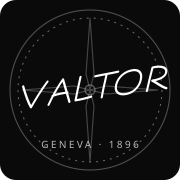

<br />


<h1>VALTOR — V9 Aquila Digital Flagship</h1>

<p>
  <strong>Hand-Built Swiss Coachwork &amp; Aviation-Grade Engineering — Interactive Digital Atelier &amp; Motion Showcase</strong>
</p>

<p>
  <em>"ULTRA FINES INGENII — Beyond the boundaries of ingenuity, craft endures forever."</em>
</p>

<!-- Status & Architecture Shields -->
<p>
  <a href="https://annoris.github.io/valtor/"></a>
  <a href="https://github.com/annoris/valtor/stargazers"></a>
  <a href="https://vitejs.dev/"></a>
  <a href="https://gsap.com/"></a>
  <a href="https://lenis.darkroom.engineering/"></a>
  <a href="https://bun.sh/"></a>
  <a href="#-solana-web3-payment-commercial-licensing--sponsorship"></a>
  <a href="./LICENSE"></a>
</p>

<!-- Viral Social Share Triggers -->
<p>
  <a href="https://twitter.com/intent/tweet?text=Check%20out%20VALTOR%20V9%20Aquila%20%E2%80%94%20an%20editorial%20Swiss%20luxury%20automotive%20flagship%20built%20with%20GSAP%20ScrollTrigger%2C%20Lenis%20smooth%20scroll%2C%20and%20zero%20UI%20frameworks!&url=https%3A%2F%2Fgithub.com%2Fannoris%2Fvaltor"></a>
  <a href="https://www.linkedin.com/sharing/share-offsite/?url=https://github.com/annoris/valtor"></a>
  <a href="https://reddit.com/submit?url=https://github.com/annoris/valtor&title=VALTOR%20V9%20Aquila%20%E2%80%94%2060fps%20GSAP%20%2B%20Lenis%20Luxury%20Automotive%20Flagship"></a>
  <a href="#-solana-web3-payment-commercial-licensing--sponsorship"></a>
</p>

<br />

<h3>🎬 Live 60fps Scroll Walkthrough</h3>

<a href="https://annoris.github.io/valtor/">
  
</a>

<sub><strong>Live Flagship Capture</strong> — Real-time recording of the <strong>VALTOR V9 Aquila</strong> digital atelier (<a href="https://annoris.github.io/valtor/">click to experience live</a>): Lenis 1.3 inertial scroll, GSAP 3.15 ScrollTrigger choreography, 3-layer spatial parallax, clip-path dark feature cinema, heritage archival collage, and split-screen boutique.</sub>

<br /><br />

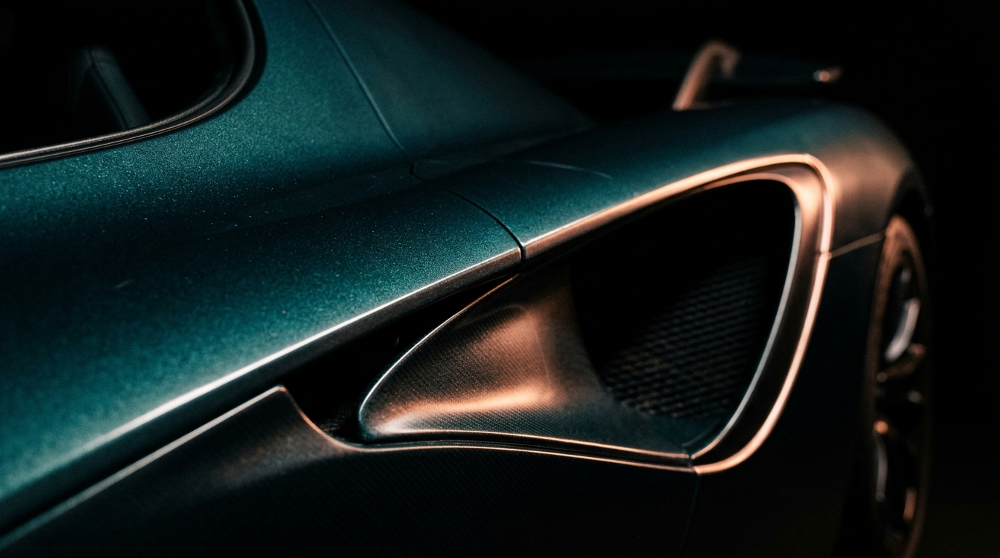

<sub><strong>Section 01 · Hero Canvas</strong> — Full-bleed studio portrait of the mid-engine <strong>VALTOR V9 Aquila</strong> finished in deep emerald-teal metallic coachwork (`#0F2B28`) with satin brushed aluminum aerodynamic intake blades and forged turbine-spoke alloy wheels.</sub>

</div>

---

## ⚡ Elevator Pitch

**VALTOR — V9 Aquila Digital Flagship** is an Awwwards-grade luxury automotive flagship experience crafted for **VALTOR Automobiles S.A.**, a bespoke Geneva-based coachbuilder and aviation-grade engineering house founded in **1896**.

Built with **100% pure modular ES Modules**, **GSAP 3.15 + ScrollTrigger**, **Lenis 1.3 inertial scrolling**, and a **custom zero-dependency `SplitText` typographic engine**, this repository proves that ultra-luxury editorial choreography, 3-layer spatial parallax, interactive inline cinema players, and multi-axis archival collages can run at a locked **60 FPS** with **zero bloated UI frameworks**.

> [!TIP]
> **Love this architecture?** Hit the **★ Star** button at the top-right of this repository to bookmark the motion engine patterns and support open-source creative engineering!

---

## 🧭 Table of Contents

1. [Why VALTOR Stands Out](#-why-valtor-stands-out)
2. [Complete Visual Showcase & Section-by-Section Breakdown](#-complete-visual-showcase--section-by-section-breakdown)
   - [01 · Preloader & Hero Flagship Stage](#01--preloader--hero-flagship-stage)
   - [02 · Editorial Intro & 3-Layer Parallax Craft Gallery](#02--editorial-intro--3-layer-parallax-craft-gallery)
   - [03 · Clip-Path Dark Feature Film & Inline Kinetic Cinema Player](#03--clip-path-dark-feature-film--inline-kinetic-cinema-player)
   - [04 · Dual-Axis Heritage Archival Collage (1896 – 1962)](#04--dual-axis-heritage-archival-collage-1896--1962)
   - [05 · Split-Screen Boutique Carousel & Shopping Bag Drawer](#05--split-screen-boutique-carousel--shopping-bag-drawer)
   - [06 · Partnerships & News Editorial Grid](#06--partnerships--news-editorial-grid)
   - [07 · Full-Bleed Cockpit Newsletter Capture & Navigation Overlay](#07--full-bleed-cockpit-newsletter-capture--navigation-overlay)
3. [Motion Engine & System Architecture](#-motion-engine--system-architecture)
4. [Design System & Swiss Typographic Tokens](#-design-system--swiss-typographic-tokens)
5. [Quick Start & Zero-Docker Local Development](#-quick-start--zero-docker-local-development)
6. [Solana Web3 Payment, Commercial Licensing & Sponsorship](#-solana-web3-payment-commercial-licensing--sponsorship)
7. [Roadmap & Contribution Guidelines](#-roadmap--contribution-guidelines)

---

## 🏆 Why VALTOR Stands Out

| Capability | Typical Luxury Agency Site | VALTOR V9 Aquila Flagship |
| :--- | :--- | :--- |
| **Runtime Footprint** | Heavy React/Next.js + 400KB+ hydration | **Zero-Framework Vanilla ES Modules** (~15KB app code) |
| **Text Splitting Engine** | Paid GSAP Club plugin or heavy third-party DOM library | **Custom Dependency-Free `SplitText`** (chars, words & masked lines) |
| **Scroll Synchronization** | Jittery native scroll + separate requestAnimationFrame | **Lenis 1.3 locked to `gsap.ticker`** (`lagSmoothing(0)`) |
| **Spatial Parallax** | Single-layer `background-attachment: fixed` | **3-Nested Wrapper Parallax** + **Dual Scroll/Pointer Collage** |
| **Cinema Experience** | External YouTube iframe embed | **Custom HTML5 Canvas + 5-Frame Kinetic Film Player Overlay** |
| **Resilience & Fallbacks** | Blank screen if animations fail | **Graceful UI Controller Fallback Flags** + `prefers-reduced-motion` support |
| **Deployment Portability** | Root-coupled asset paths | **Relative `./` Vite Base** — works on any domain or GitHub Pages subpath |

---

## 🖼️ Complete Visual Showcase & Section-by-Section Breakdown

Every single visual asset in this repository is bespoke-curated and stored in [`public/images/`](./public/images/) so that both the live Vite application and this GitHub documentation render 100% natively. Below is the complete tour of the website's 15 visual assets (13 high-resolution photographs + 2 bespoke SVG brand marks) and the engineering behind each section.

---

### 01 · Preloader & Hero Flagship Stage

**Components (Private Vault — [Unlock Source](./SOURCE_ACCESS.md)):** `src/components/preloader.js` · `src/components/header.js` · `src/components/hero.js` · `src/animations/preloader.js`

<div align="center">
  
</div>

#### Architectural & Visual Highlights:
- **SVG Stroke Draw-On Preloader:** Upon entry, a full-viewport obsidian curtain (`#000000`) renders the tilted calligraphic VALTOR wordmark ([`public/images/valtor-wordmark.svg`](./public/images/valtor-wordmark.svg)). GSAP measures every `<path>` via `getTotalLength()` and animates `stroke-dashoffset` to zero before sliding the curtain upward (`yPercent: -100`, `power4.inOut`).
- **Oversized Hero Media Container:** The hero image (`./public/images/hero-v9-aquila.jpg`) is housed inside an oversized `120%` height container (`top: -10%`), enabling smooth downward parallax scrubbing (`yPercent: 18`) as the user scrolls past the fold without ever exposing blank edges.
- **Choreographed Character Cascade:** The `GENEVA ATELIER EDITION` eyebrow, two-line `120px` `Barlow Condensed` display headline (`THE NEXT CHAPTER OF / VALTOR`), and dual-layer kinetic CTA button (`DISCOVER THE VALTOR V9 AQUILA`) cascade into view in sync with the preloader curtain lift.
- **Adaptive Sticky Header:** The fixed top bar automatically switches from transparent dark-stage mode to a crisp white architectural bar (`is-scrolled`) with a `1px` `#B2B2B2` hairline border once the user scrolls past the hero threshold.

---

### 02 · Editorial Intro & 3-Layer Parallax Craft Gallery

**Components (Private Vault — [Unlock Source](./SOURCE_ACCESS.md)):** `src/components/editorialIntro.js` · `src/components/gallery.js` · `src/animations/scrollTriggers.js`

Following the hero, the **Editorial Intro** (`PURE DEVOTION`) introduces the V9 Aquila commissioning philosophy using scroll-scrubbed line opacity (`[data-scrub-lines]`), transitioning directly into an asymmetric 12-column **3-Layer Parallax Craft Gallery**:

<table>
  <thead>
    <tr>
      <th width="33%" align="center">I · Bespoke Honeycomb Mesh</th>
      <th width="33%" align="center">II · Billet Turbine Tail-Lights</th>
      <th width="33%" align="center">III · Milled Titanium Exhausts</th>
    </tr>
  </thead>
  <tbody>
    <tr>
      <td align="center">
        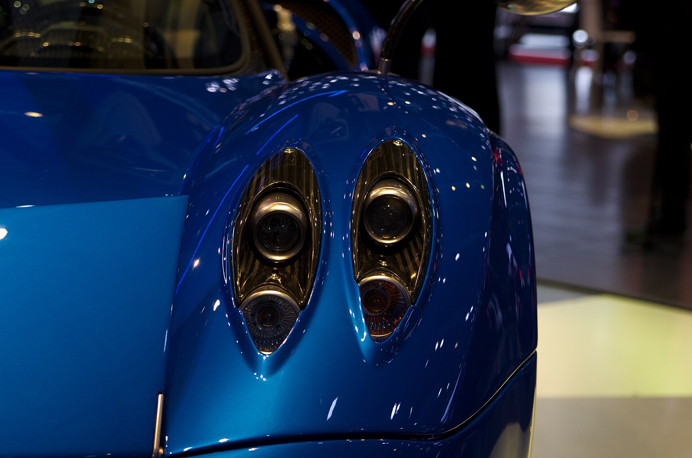
      </td>
      <td align="center">
        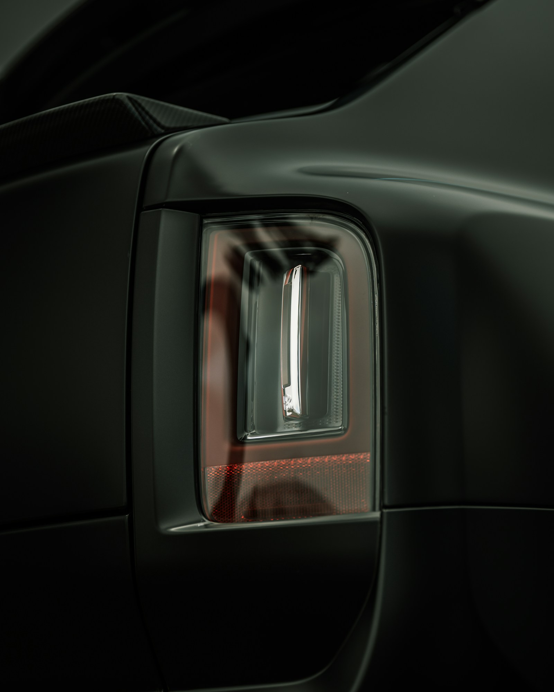
      </td>
      <td align="center">
        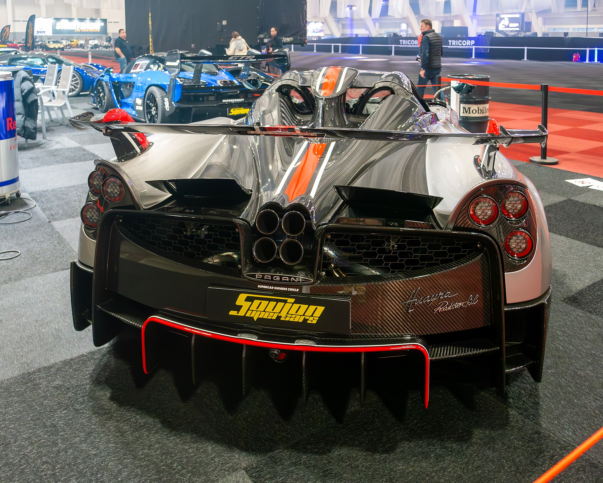
      </td>
    </tr>
    <tr>
      <td valign="top">
        <strong>Asset:</strong> <code>./public/images/craft-intake-mesh.jpg</code><br /><br />
        <strong>Grid Placement:</strong> Columns 8–10 (Span 3)<br /><br />
        <strong>Engineering Story:</strong> Hand-woven titanium and brushed aluminum honeycomb mesh formed over wooden bucks and secured with flush aviation rivets to channel laminar cooling airflow across the carbon monocoque.
      </td>
      <td valign="top">
        <strong>Asset:</strong> <code>./public/images/craft-turbine-lamp.jpg</code><br /><br />
        <strong>Grid Placement:</strong> Columns 2–4 (Span 3, Staggered)<br /><br />
        <strong>Engineering Story:</strong> Machined from solid aerospace-grade aluminum billets, the recessed turbine LED tail-lights pay tribute to VALTOR's 1920s rotary aero-engine lineage with concentric crimson-amber light blades.
      </td>
      <td valign="top">
        <strong>Asset:</strong> <code>./public/images/craft-billet-exhaust.jpg</code><br /><br />
        <strong>Grid Placement:</strong> Columns 8–10 (Span 3, Deep Stagger)<br /><br />
        <strong>Engineering Story:</strong> Twin central CNC-milled brushed titanium exhaust outlets with heat-blued internal patina integrated into a wind-tunnel-sculpted carbon-and-aluminum rear diffuser.
      </td>
    </tr>
  </tbody>
</table>

#### How the 3-Nested Parallax Wrapper Works:
Each gallery card uses three concentric DOM layers (`[data-parallax-media-shift]` → `[data-parallax-media-frame]` → `[data-parallax-media-inner]`) to separate outer card velocity from inner image counter-translation and subtle scale decompression (`scale: 1.12 → 1.0`).

---

### 03 · Clip-Path Dark Feature Film & Inline Kinetic Cinema Player

**Components (Private Vault — [Unlock Source](./SOURCE_ACCESS.md)):** `src/components/darkFeature.js` · `src/components/uiController.js`

<div align="center">
  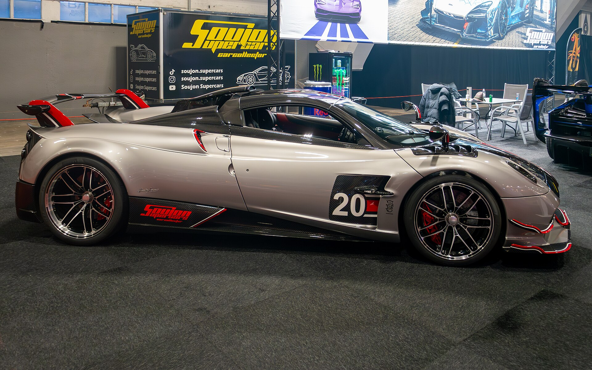
</div>

#### Architectural & Visual Highlights:
- **Hardware-Accelerated Clip-Path Reveal:** As `#v9-aquila` enters the viewport, `[data-section-dark]` expands smoothly from an inset frame (`clip-path: inset(0% 7% 0% 7%)`) to a full-bleed `#000000` cinema hall (`clip-path: inset(0% 0% 0% 0%)`) scrubbed directly to scroll progress.
- **Latin Motto Display:** Displays VALTOR's historic motto **`ULTRA FINES INGENII`** (*"Beyond the boundaries of ingenuity, craft endures forever."*) above a 16:9 low-key obsidian profile poster (`./public/images/feature-obsidian-profile.jpg`).
- **Interactive Inline Cinema Player (`01:24`):** Clicking **Play video** launches a self-contained cinema engine right inside the stage—combining a 5-frame kinetic photography sequence (`feature-obsidian-profile.jpg`, `hero-v9-aquila.jpg`, `craft-intake-mesh.jpg`, `craft-turbine-lamp.jpg`, `craft-billet-exhaust.jpg`), an HTML5 `<canvas>` procedural light-streak & telemetry overlay, film grain texture, scrubbable timeline slider, pause/play toggle, mute control, and native Fullscreen API integration.

---

### 04 · Dual-Axis Heritage Archival Collage (1896 – 1962)

**Components (Private Vault — [Unlock Source](./SOURCE_ACCESS.md)):** `src/components/heritage.js` · `src/animations/heritageParallax.js`

The **Heritage Section** (`SINCE 1896 — A CENTURY OF AVIATION & COACHWORK`) surrounds a centered foreground narrative stack with **7 floating archival collage tiles** derived from 4 museum-grade historical and tactile assets:

<table>
  <thead>
    <tr>
      <th width="25%" align="center">1896 · Geneva Atelier</th>
      <th width="25%" align="center">1924 · Rotary Aero-Engine</th>
      <th width="25%" align="center">1962 · Alpine Endurance</th>
      <th width="25%" align="center">Saddlery &amp; Driving Craft</th>
    </tr>
  </thead>
  <tbody>
    <tr>
      <td align="center">
        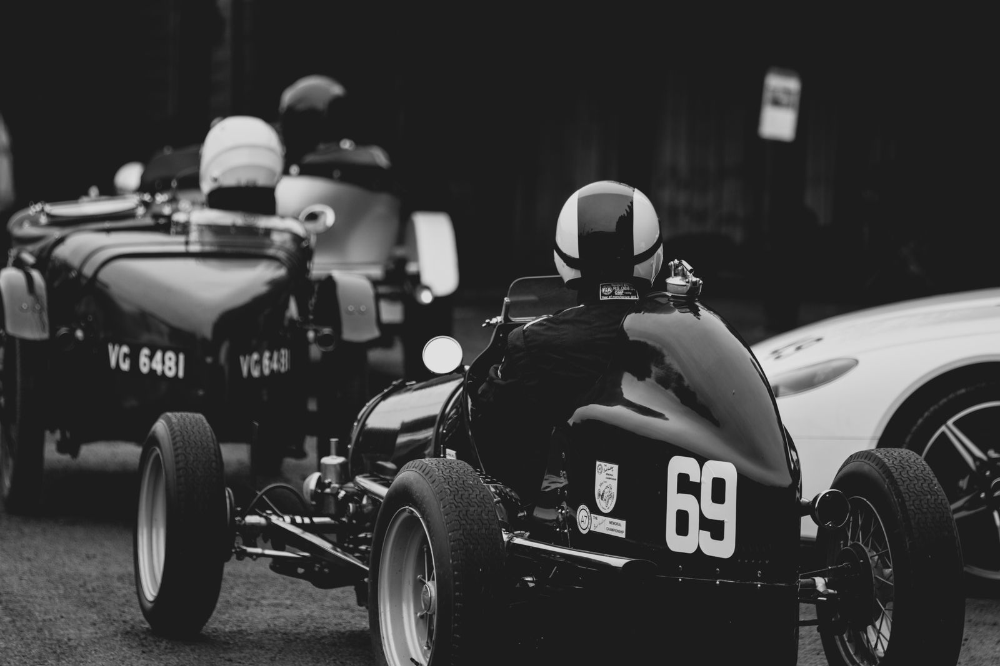
      </td>
      <td align="center">
        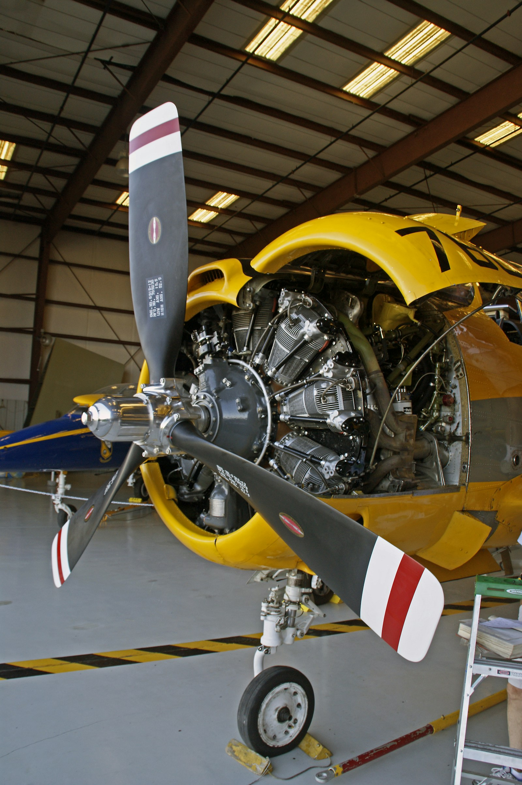
      </td>
      <td align="center">
        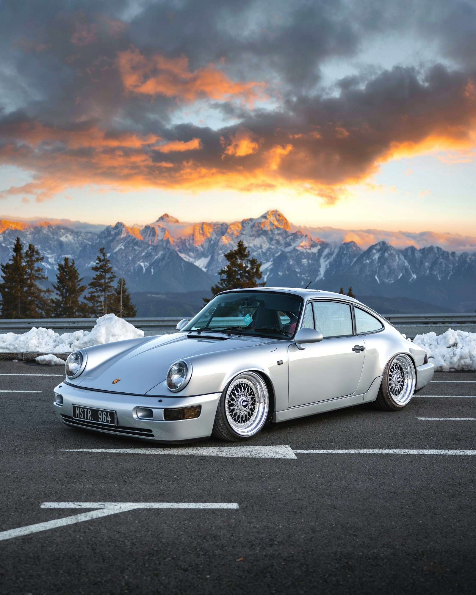
      </td>
      <td align="center">
        
      </td>
    </tr>
    <tr>
      <td valign="top">
        <strong>Asset:</strong> <code>./public/images/heritage-1896-atelier.jpg</code><br /><br />
        <strong>Collage Tiles:</strong> Tile 1 (<code>depth: 0.18</code>) &amp; Tile 5 (<code>depth: 0.14</code>)<br /><br />
        <strong>Archival Context:</strong> Sepia silver-gelatin photograph of master craftsmen hand-beating curved aluminum coachwork panels over wooden bucks in Geneva.
      </td>
      <td valign="top">
        <strong>Asset:</strong> <code>./public/images/heritage-1924-aviation.jpg</code><br /><br />
        <strong>Collage Tiles:</strong> Tile 2 (<code>depth: 0.32</code>) &amp; Tile 6 (<code>depth: 0.28</code>)<br /><br />
        <strong>Archival Context:</strong> High-contrast 1924 monochrome photograph of a gleaming polished-aluminum VALTOR rotary aero-engine mounted on an Alpine airfield tarmac.
      </td>
      <td valign="top">
        <strong>Asset:</strong> <code>./public/images/heritage-1962-alpine.jpg</code><br /><br />
        <strong>Collage Tiles:</strong> Tile 3 (<code>depth: 0.24</code>) &amp; Tile 7 (<code>depth: 0.22</code>)<br /><br />
        <strong>Archival Context:</strong> 1962 endurance trial photograph of a hand-built aluminum grand tourer ascending a misty Swiss Alpine mountain pass.
      </td>
      <td valign="top">
        <strong>Asset:</strong> <code>./public/images/boutique-gloves.jpg</code><br /><br />
        <strong>Collage Tile:</strong> Tile 4 (<code>depth: 0.40</code>)<br /><br />
        <strong>Archival Context:</strong> Bespoke cognac lambskin driving gloves with knuckle perforations and brushed aluminum snap fasteners bridging heritage and tactile luxury.
      </td>
    </tr>
  </tbody>
</table>

#### Dual-Wrapper Orthogonal Motion:
To prevent GSAP scroll transforms and mouse-move transforms from overwriting each other on the same DOM node, each tile is split into:
1. **Outer Scroll Node (`[data-heritage-scroll]`):** Driven vertically by `ScrollTrigger` according to `data-scroll-speed`.
2. **Inner Pointer Node (`[data-racing-heritage-mouse]`):** Driven in 2D (`x`, `y`) by `gsap.quickTo()` cursor interpolation scaled by `data-depth`.

---

### 05 · Split-Screen Boutique Carousel & Shopping Bag Drawer

**Components (Private Vault — [Unlock Source](./SOURCE_ACCESS.md)):** `src/components/boutique.js` · `src/components/drawers.js` · `src/animations/interactions.js`

The **Boutique Section** (`OBJECTS OF ENDURING CRAFT`) pairs an archival monochrome backdrop (`./public/images/heritage-1924-aviation.jpg`) with a floating white product card that cycles through **4 bespoke collector editions** synchronized with a `143px` 1px progress indicator and a live **Shopping Bag Drawer**:

<table>
  <thead>
    <tr>
      <th width="25%" align="center">01 · The Art of VALTOR ($65)</th>
      <th width="25%" align="center">02 · Grand Tourer Weekender ($1,450)</th>
      <th width="25%" align="center">03 · Calibre V9 Chronograph ($4,800)</th>
      <th width="25%" align="center">04 · Alpine Driving Gloves ($320)</th>
    </tr>
  </thead>
  <tbody>
    <tr>
      <td align="center">
        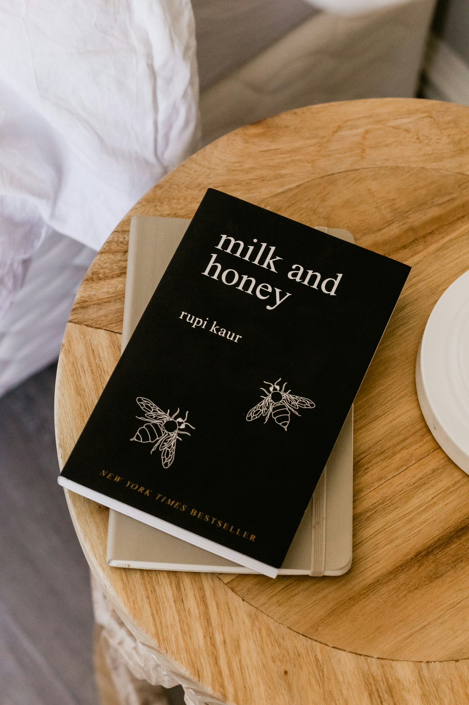
      </td>
      <td align="center">
        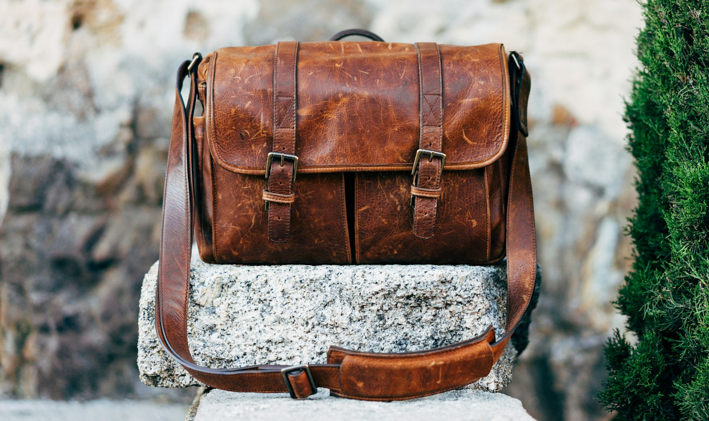
      </td>
      <td align="center">
        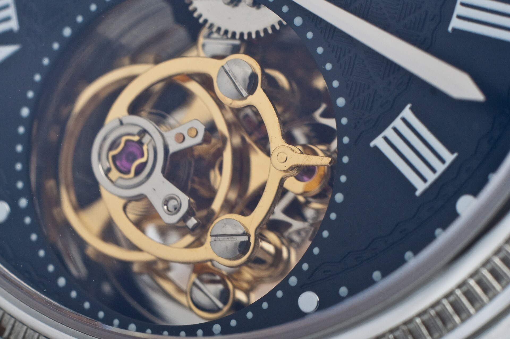
      </td>
      <td align="center">
        
      </td>
    </tr>
    <tr>
      <td valign="top">
        <strong>Asset:</strong> <code>./public/images/boutique-monograph.jpg</code><br /><br />
        <strong>Edition:</strong> Linen-Bound Atelier Monograph — 320 Pages<br /><br />
        <strong>Details:</strong> Blind-debossed geometric turbine emblem on dark charcoal linen hardcover resting on a pale honed travertine plinth.
      </td>
      <td valign="top">
        <strong>Asset:</strong> <code>./public/images/boutique-weekender.jpg</code><br /><br />
        <strong>Edition:</strong> Hand-Stitched Cognac Saddle Leather &amp; Titanium Hardware<br /><br />
        <strong>Details:</strong> Full-grain cognac hides with diamond-stitched side panels and solid brushed-titanium buckles. Also powers the Shopping Bag empty state visual.
      </td>
      <td valign="top">
        <strong>Asset:</strong> <code>./public/images/boutique-chronograph.jpg</code><br /><br />
        <strong>Edition:</strong> Grade-5 Brushed Titanium Mechanical Movement<br /><br />
        <strong>Details:</strong> Skeletonized haute-horlogerie chronograph with obsidian dial, exposed gear train, turbine sub-dials, and cognac strap.
      </td>
      <td valign="top">
        <strong>Asset:</strong> <code>./public/images/boutique-gloves.jpg</code><br /><br />
        <strong>Edition:</strong> Cashmere-Lined Cognac Lambskin with Milled Snaps<br /><br />
        <strong>Details:</strong> Tailored driving gloves lined in fine charcoal cashmere with machined aluminum snap fasteners.
      </td>
    </tr>
  </tbody>
</table>

#### Interactive Commerce & Shopping Bag Flow:
- Clicking **ADD TO BAG** on any slide adds the item to the reactive cart state, updates the header bag counter badge (`[data-cart-count]`), and opens the `730px` right-hand **Shopping Bag Drawer** (`#cart-drawer`).
- Users can increment/decrement quantities, remove items, inspect the live subtotal, and trigger a **REQUEST PRIVATE ORDER** concierge dispatch.

---

### 06 · Partnerships & News Editorial Grid

**Component (Private Vault — [Unlock Source](./SOURCE_ACCESS.md)):** `src/components/news.js`

The **Partnerships & News** section presents a 3-column Swiss editorial grid on desktop (and a touch-friendly horizontal snap-slider on mobile viewports) highlighting key dispatches from the Meyrin atelier:

<table>
  <thead>
    <tr>
      <th width="33%" align="center">14 OCT 2026 · PRESS RELEASE</th>
      <th width="33%" align="center">28 AUG 2026 · PRESS RELEASE</th>
      <th width="33%" align="center">19 JUN 2026 · EVENTS</th>
    </tr>
  </thead>
  <tbody>
    <tr>
      <td align="center">
        
      </td>
      <td align="center">
        
      </td>
      <td align="center">
        
      </td>
    </tr>
    <tr>
      <td valign="top">
        <strong>VALTOR Unveils the V9 Aquila Production Specification in Geneva</strong><br /><br />
        Following two years of wind-tunnel refinement and bespoke metallurgical testing, the hand-built V9 Aquila enters private client commissioning at our Meyrin atelier.
      </td>
      <td valign="top">
        <strong>A New Mechanical Alliance: The Calibre V9 Titanium Chronograph</strong><br /><br />
        Crafted alongside independent Swiss watchmakers, each numbered timepiece shares the exact billet titanium alloy and turbine motif of the V9 Aquila cockpit.
      </td>
      <td valign="top">
        <strong>VALTOR Heritage Convoy Returns to the Furka &amp; Gotthard Passes</strong><br /><br />
        Collectors and atelier engineers gathered across three days of high-altitude driving to celebrate 130 years of Swiss coachbuilding and aviation heritage.
      </td>
    </tr>
  </tbody>
</table>

---

### 07 · Full-Bleed Cockpit Newsletter Capture & Navigation Overlay

**Components (Private Vault — [Unlock Source](./SOURCE_ACCESS.md)):** `src/components/newsletter.js` · `src/components/drawers.js` · `src/components/footer.js`

<div align="center">
  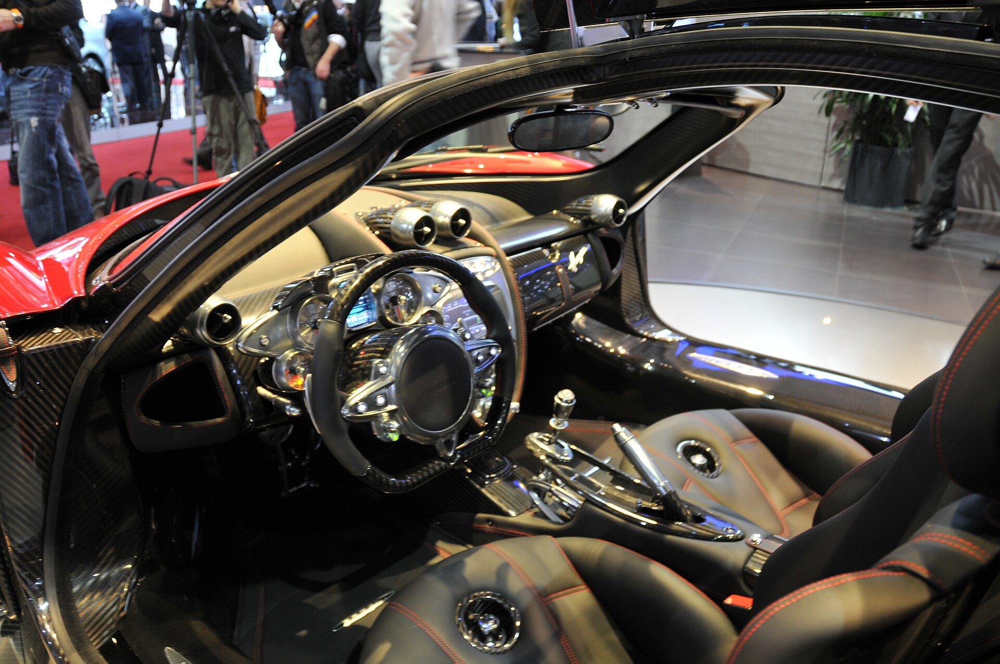
</div>

#### Architectural & Visual Highlights:
- **Bespoke Cockpit Interior (`./public/images/newsletter-cockpit.jpg`):** Showcases the V9 Aquila's hand-stitched full-grain cognac saddle leather cabin, CNC-milled titanium switchgear, exposed mechanical linkages, and aviation instrumentation.
- **Dual Placement:**
  1. **Section 08 Full-Bleed Newsletter Capture (`120vh`):** Layered beneath a dual linear-gradient scrim to frame the left-aligned `Register for Exclusive Updates` capture form.
  2. **Top-Anchored Navigation Menu Overlay (`#menu-overlay`):** Featured alongside the 6 primary navigation anchors (`Home`, `V9 Aquila`, `Heritage`, `Boutique`, `News`, `Contact`) and the 5-column Geneva HQ concierge directory.
- **4-Column Swiss Footer & Heritage Crest:** Anchored by the 180×180 aviation-propeller **VALTOR Heritage Crest** ([`public/images/valtor-crest.svg`](./public/images/valtor-crest.svg)), direct triggers for the **Newsletter Drawer** (`708px`) and **Cookie Preferences Modal**, and legal links.

---

## 🧠 Motion Engine & System Architecture

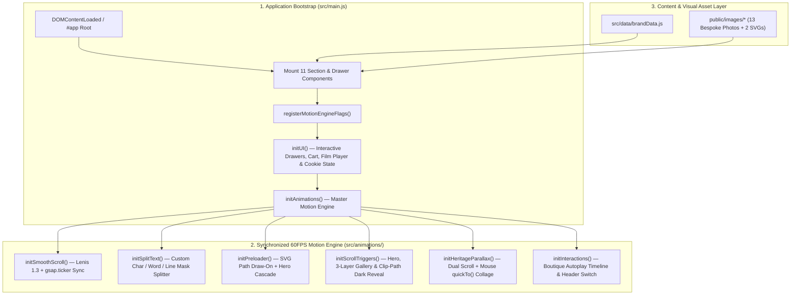

### Complete Visual Asset Manifest (`public/images/`)

| # | Asset Path | Dimensions / Aspect | Primary Section(s) |
| :-: | :--- | :--- | :--- |
| 01 | [`public/images/hero-v9-aquila.jpg`](./public/images/hero-v9-aquila.jpg) | `16:9` Full-Bleed | Section 01 Hero Background & Film Sequence Frame 2 |
| 02 | [`public/images/craft-intake-mesh.jpg`](./public/images/craft-intake-mesh.jpg) | `4:5` Editorial Portrait | Section 03 Parallax Gallery Item 1 & Film Frame 3 |
| 03 | [`public/images/craft-turbine-lamp.jpg`](./public/images/craft-turbine-lamp.jpg) | `4:5` Editorial Portrait | Section 03 Parallax Gallery Item 2 & Film Frame 4 |
| 04 | [`public/images/craft-billet-exhaust.jpg`](./public/images/craft-billet-exhaust.jpg) | `4:5` Editorial Portrait | Section 03 Parallax Gallery Item 3 & Film Frame 5 |
| 05 | [`public/images/feature-obsidian-profile.jpg`](./public/images/feature-obsidian-profile.jpg) | `16:9` Cinema Widescreen | Section 04 Dark Feature Film Poster, Film Frame 1 & News Article 1 |
| 06 | [`public/images/heritage-1896-atelier.jpg`](./public/images/heritage-1896-atelier.jpg) | `4:3` Archival Landscape | Section 05 Heritage Collage (Tiles 1 & 5) |
| 07 | [`public/images/heritage-1924-aviation.jpg`](./public/images/heritage-1924-aviation.jpg) | `3:4` Archival Portrait | Section 05 Heritage Collage (Tiles 2 & 6) & Section 06 Boutique Backdrop |
| 08 | [`public/images/heritage-1962-alpine.jpg`](./public/images/heritage-1962-alpine.jpg) | `16:10` Archival Landscape | Section 05 Heritage Collage (Tiles 3 & 7) & News Article 3 |
| 09 | [`public/images/boutique-monograph.jpg`](./public/images/boutique-monograph.jpg) | `4:5` Studio Product | Section 06 Boutique Slide 1 (*The Art of VALTOR* — $65) |
| 10 | [`public/images/boutique-weekender.jpg`](./public/images/boutique-weekender.jpg) | `16:10` Studio Product | Section 06 Boutique Slide 2 (*Grand Tourer Weekender* — $1,450) & Cart Drawer |
| 11 | [`public/images/boutique-chronograph.jpg`](./public/images/boutique-chronograph.jpg) | `4:5` Macro Horology | Section 06 Boutique Slide 3 (*Calibre V9 Chronograph* — $4,800) & News Article 2 |
| 12 | [`public/images/boutique-gloves.jpg`](./public/images/boutique-gloves.jpg) | `4:5` Studio Product | Section 06 Boutique Slide 4 (*Alpine Driving Gloves* — $320) & Heritage Tile 4 |
| 13 | [`public/images/newsletter-cockpit.jpg`](./public/images/newsletter-cockpit.jpg) | `16:9` Cockpit Interior | Section 08 Full-Bleed Newsletter Capture & Top Navigation Overlay |
| 14 | [`public/images/valtor-crest.svg`](./public/images/valtor-crest.svg) | `1:1` Vector Emblem | Footer Heritage Crest & README Hero Badge |
| 15 | [`public/images/valtor-wordmark.svg`](./public/images/valtor-wordmark.svg) | `240:54` Calligraphic SVG | Preloader Draw-On Wordmark & Sticky Header Brand Mark |

---

## 🎨 Design System & Swiss Typographic Tokens

Defined in `src/styles/tokens.css` ([Private Source Vault](./SOURCE_ACCESS.md)) and documented in [`docs/BRAND_SPEC.md`](./docs/BRAND_SPEC.md), the visual system enforces a strict monochrome architectural palette so the warm metallic and saddle-leather photography commands total visual authority.

| Token Category | CSS Custom Property | Value | Role |
| :--- | :--- | :--- | :--- |
| **Core Surfaces** | `--color-bg-light` | `#FFFFFF` | Primary editorial gallery canvas |
| | `--color-bg-dark` | `#000000` | Preloader, Hero & Clip-Path Dark Feature Film stage |
| | `--color-surface-card` | `#F0F0F0` | News & Boutique card media surfaces |
| | `--color-surface-drawer` | `#FDFEFE` | Right-hand Shopping Bag & Newsletter drawers |
| **Typography** | `--font-display` | `'Barlow Condensed'` | Ultra-condensed architectural uppercase headlines (`500`–`700`) |
| | `--font-sans` | `'Inter'` | Swiss grotesque body copy, navigation & micro-eyebrows (`0.18em` tracking) |
| | `--font-serif` | `'PT Serif'` | Heritage numerals, italic motto accents & editorial quotes |
| **Photography Accents** | `--accent-emerald-coachwork` | `#0F2B28` | Deep emerald-teal metallic coachwork tone |
| | `--accent-cognac-leather` | `#8C4A27` | Hand-stitched full-grain cognac saddle leather |
| | `--accent-brushed-titanium` | `#B8BDC0` | Grade-5 CNC-milled billet titanium & aluminum trim |

---

## 🚀 Quick Start & Zero-Docker Local Development

> [!IMPORTANT]
> **Solana-Gated Sponsorware Architecture (`annoris/valtor-pro-source`):**
> - **Live Flagship Showcase:** Anyone can explore the live 60fps production flagship at **[https://annoris.github.io/valtor/](https://annoris.github.io/valtor/)** and inspect all 15 visual sections, design tokens, and architectural blueprints right here in this public showcase repository.
> - **Full Editable Source Code Vault:** The complete, unminified, editable source code (`src/animations/`, `src/components/`, `src/data/`, `src/styles/`, `src/main.js`, `index.html`, `vite.config.js`, and `package.json`) is hosted inside the **Private Source Vault (`annoris/valtor-pro-source`)** and unlocked immediately upon contributing via **Solana Mainnet (`3HvUMCUSSHEdtA35UuD4J7mbgpTxJ7LgT2X7GfdzvBdm`)** and submitting a **[🔓 Solana Source Code Unlock Request](https://github.com/annoris/valtor/issues/new?template=source_unlock_request.md)**. See [`SOURCE_ACCESS.md`](./SOURCE_ACCESS.md) and [`PAYMENT.md`](./PAYMENT.md) for instant unlock instructions.

Once your GitHub account has been granted access to **`annoris/valtor-pro-source`**, VALTOR runs natively in milliseconds with **Bun** (recommended) or **Node.js / npm** — zero Docker containers, zero database setup, and zero environment variable configuration required.

### 1. Clone the Private Source Vault & Install

```bash
# Clone the full editable source vault (after Solana unlock verification)
git clone https://github.com/annoris/valtor-pro-source.git
cd valtor-pro-source

# Install dependencies with Bun (Recommended)
bun install

# Or with npm
npm install
```

### 2. Start the Development Server

```bash
# With Bun
bun run dev

# Or with npm
npm run dev
```

Open **`http://localhost:5173`** in your browser to experience the 60fps GSAP + Lenis flagship showcase locally.

### 3. Build & Preview Production Bundle

```bash
# Build optimized static bundle into dist/
bun run build

# Preview production build locally
bun run preview
```

> [!NOTE]
> `vite.config.js` (included in the private vault) is preconfigured with `base: './'`, ensuring that all 13 photographic assets and font imports resolve cleanly whether deployed to a custom root domain (`https://valtorautomobiles.com`) or a GitHub Pages repository subpath (`https://annoris.github.io/valtor/`).

---

## 💎 Solana Web3 Payment, Commercial Licensing & Sponsorship

Supporting open-source luxury creative engineering, unlocking the private source vault (`annoris/valtor-pro-source`), or acquiring commercial white-label rights can be settled in seconds simply by scanning our official **Receive SOL** QR code below.

<div align="center">

### Scan to Pay with Any Solana Wallet (`SOL`)

<p>
  
  
  
</p>

<a href="https://solscan.io/account/3HvUMCUSSHEdtA35UuD4J7mbgpTxJ7LgT2X7GfdzvBdm">
  
</a>

<br />

```text
3HvUMCUSSHEdtA35UuD4J7mbgpTxJ7LgT2X7GfdzvBdm
```

<sub><strong>1-Step Payment:</strong> Scan the QR code above with Phantom, Solflare, Backpack, Coinbase, Binance, or Trust Wallet (or copy the Solana address above) to send <strong>SOL</strong> directly.</sub>

</div>

### Sponsorship & Commercial Licensing Tiers

| Tier | Contribution (`SOL` / `USDC` Equivalent) | Deliverables & Benefits |
| :--- | :--- | :--- |
| **⚡ Atelier Supporter** | `0.25 SOL` (~$50) | Listed in the **Hall of Patrons** in this `README.md` + priority GitHub issue triage. |
| **🏎️ Bespoke Studio License** | `1.50 SOL` (~$300) | Commercial agency & studio license for client projects + priority feature requests. |
| **🦅 Geneva Concierge Partner** | `5.00 SOL` (~$1,000+) | Custom brand adaptation, bespoke GSAP ScrollTrigger choreography consulting, and dedicated co-branding. |

#### How to Verify Your Solana Transaction:
1. Send your contribution in **SOL** or **USDC (SPL)** on **Solana Mainnet-Beta** to:
   `3HvUMCUSSHEdtA35UuD4J7mbgpTxJ7LgT2X7GfdzvBdm`
2. Copy your **Solscan / Solana Explorer Transaction Signature**.
3. Open a GitHub Issue or contact the studio with your transaction hash to activate your sponsorship badge or commercial license.

---

## 🗺️ Roadmap & Contribution Guidelines

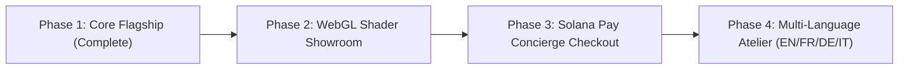

- [x] **Phase 1:** Complete 8-section editorial narrative, custom `SplitText` engine, 3-layer parallax gallery, dual-axis heritage collage, inline kinetic film player, and reactive shopping bag drawer.
- [ ] **Phase 2:** Interactive 3D / WebGL coachwork paint & cognac leather configurator for the V9 Aquila.
- [ ] **Phase 3:** Direct **Solana Pay** QR modal inside the Boutique Shopping Bag drawer for instant on-chain collector edition checkout (`3HvUMCUSSHEdtA35UuD4J7mbgpTxJ7LgT2X7GfdzvBdm`).
- [ ] **Phase 4:** Multilingual Swiss localization (`EN`, `FR`, `DE`, `IT`) with persistent locale switching.

### Contributing
Contributions, performance optimizations, and motion refinements are welcome! See our full [Contribution Guidelines](./.github/CONTRIBUTING.md), [Code of Conduct](./.github/CODE_OF_CONDUCT.md), [Security Policy](./.github/SECURITY.md), [Source Code Unlock Guide](./SOURCE_ACCESS.md), [Commercial Licensing & Payment Guide](./PAYMENT.md), and [Hall of Patrons](./SPONSORS.md).
1. Fork this repository.
2. Create a feature branch (`git checkout -b feat/atelier-enhancement`).
3. Commit your changes (`git commit -m "feat: refine parallax easing curve"`).
4. Push to your branch and open a Pull Request.

---

<div align="center">


### ⭐ Star This Repository If It Inspired Your Next Flagship Build!

<p>
  <strong>VALTOR Automobiles S.A.</strong> · Route de l'Aéroport 42, 1215 Meyrin, Geneva, Switzerland<br />
  <sub>MIT License © 2026 VALTOR Automobiles S.A. · Atelier Digital by Maison Nord</sub>
</p>

</div>
